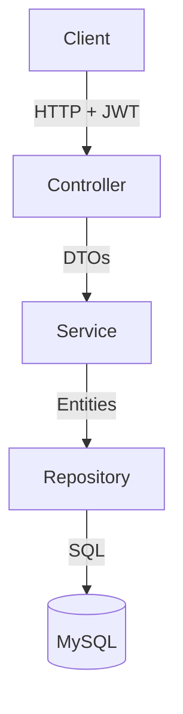
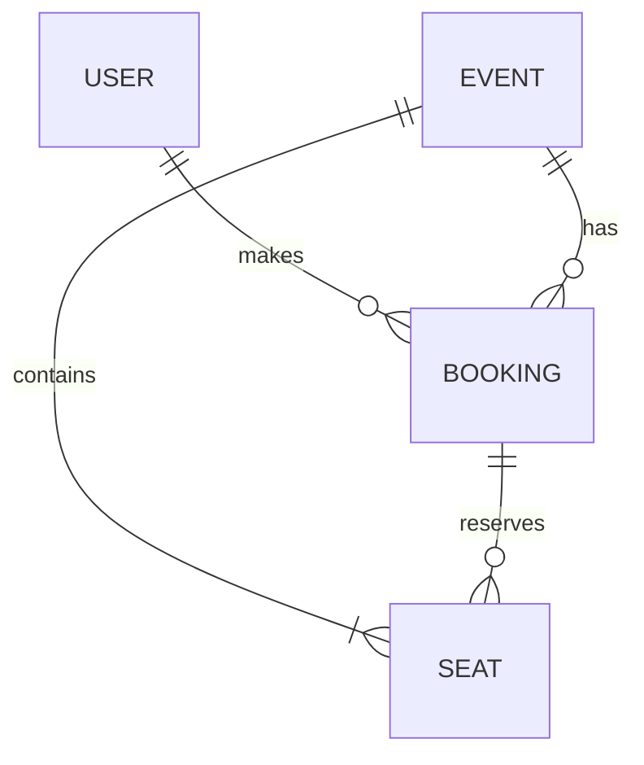

# Seat Booking System

A Spring Boot REST API for event seat booking. Users browse events, view seat availability, book seats, and cancel bookings. Booking is concurrency-safe: a seat cannot be double-booked, even when many requests arrive at the same moment.


## Highlights

- **Concurrency-safe booking:** pessimistic write locking inside a single transaction prevents two users from booking the same seat.
- **All-or-nothing bookings:** if any requested seat is unavailable, the whole request fails and nothing is saved.
- **JWT authentication:** Spring Security with BCrypt password hashing and role-based access (USER / ADMIN).
- **Ownership checks:** users can only view and cancel their own bookings.
- **Tested under concurrent load:** a 50-thread test books the same seat simultaneously and checks that exactly one request succeeds.

## Features

**Events**
- Create events (admin only); seats are generated automatically
- List events with pagination
- View event details and seat availability

**Booking**
- Book multiple seats in one atomic transaction
- View your own bookings
- Cancel a booking, which releases its seats

**Authentication and authorization**
- Register and log in; login returns a JWT
- Passwords stored as BCrypt hashes
- Admin-only endpoints for event creation
- Users cannot cancel or view other users' bookings

**Error handling**
- Global exception handler with a consistent JSON error format
- Request validation with field-level messages
- Meaningful status codes (400, 403, 404, 409)

## Tech Stack

| Area | Technology |
|---|---|
| Language | Java 17 |
| Framework | Spring Boot 3.x |
| Security | Spring Security, JWT (jjwt), BCrypt |
| Persistence | Spring Data JPA / Hibernate |
| Database | MySQL 8 |
| Utilities | Lombok |
| Testing | JUnit 5, Mockito |
| Build tool | Maven |

## Architecture

The application uses a layered architecture. Controllers handle HTTP and validation, services contain the business logic and transactions, and repositories talk to the database. DTOs are used for requests and responses so entities are never exposed directly.



### Database model



Tables: `users`, `events`, `seats`, `bookings`. Each seat belongs to one event and references its current booking, which is cleared when that booking is cancelled. Seat numbers (S1, S2, ...) repeat across events, so the seat `id` is what identifies a seat in API requests.

## How Double-Booking Is Prevented

**Problem:** if two requests read the same seat as available at the same moment, both can book it.

**Solution:** the booking method runs in a single `@Transactional` block. It loads the requested seats with a pessimistic write lock (`SELECT ... FOR UPDATE`), so a second request for the same seat waits until the first one commits. After the lock is acquired, it checks that every seat is available and belongs to the requested event, then marks them booked. If any seat is unavailable, an exception rolls the whole transaction back. Seats are always locked in ascending id order, so two overlapping requests cannot deadlock each other.

**Verification:** the concurrency test starts 50 threads that all try to book the same seat at once, and asserts that exactly one succeeds and the rest are rejected.

## API Documentation

| Method | Endpoint | Access | Description |
|---|---|---|---|
| POST | `/api/auth/register` | Public | Register a user |
| POST | `/api/auth/login` | Public | Log in and receive a JWT |
| POST | `/api/events` | Admin | Create an event and generate its seats |
| GET | `/api/events` | Public | List events (paginated) |
| GET | `/api/events/{id}` | Public | Event details |
| GET | `/api/events/{id}/seats` | Public | Seats and their availability |
| POST | `/api/bookings` | Authenticated | Book one or more seats |
| GET | `/api/bookings/my` | Authenticated | List the current user's bookings |
| DELETE | `/api/bookings/{id}` | Authenticated | Cancel your own booking |

Protected endpoints require the header `Authorization: Bearer <token>`.

**Common responses:** `400` invalid input, `401/403` missing or insufficient credentials, `404` resource not found, `409` seat already booked.

### Example: log in

`POST /api/auth/login`

```json
{
  "email": "user@example.com",
  "password": "your-password"
}
```

Response:

```json
{
  "token": "eyJhbGciOiJIUzI1NiJ9..."
}
```

### Example: book seats

`POST /api/bookings` with `Authorization: Bearer <token>`

```json
{
  "eventId": 1,
  "seatIds": [1, 2]
}
```

Response:

```json
{
  "bookingId": 1,
  "eventTitle": "Spring Boot Conference 2026",
  "seatNumbers": ["S1", "S2"],
  "status": "CONFIRMED"
}
```

### Example: seat already booked

Booking a seat that is already taken returns `409 Conflict` with a JSON error body, and no seats from that request are booked.

## Getting Started

### Prerequisites

- JDK 17
- Maven (or use the included `./mvnw`)
- MySQL 8

### Setup

1. Clone the repository:
   ```bash
   git clone https://github.com/YOUR_USERNAME/seatbooking.git
   cd seatbooking
   ```
2. Create the database:
   ```sql
   CREATE DATABASE seat_booking;
   ```
3. Copy `src/main/resources/application-example.properties` to `src/main/resources/application.properties` and set your MySQL username, password, and a JWT secret.
4. Run the application:
   ```bash
   ./mvnw spring-boot:run
   ```
   The API starts at `http://localhost:8080`.

### Creating an admin user

Registration creates normal users. To create an admin, register a user and then promote it in MySQL:

```sql
UPDATE users SET role = 'ADMIN' WHERE email = 'admin@example.com';
```

Log in again to get a token that carries the admin role.

> **Security note:** never commit real database passwords or JWT secrets. `application.properties` is listed in `.gitignore`.

## Testing

```bash
./mvnw test
```

The test suite includes unit tests for the service layer and a concurrency test. The concurrency test creates an event, starts 50 threads that try to book the same seat simultaneously, and asserts that exactly one booking succeeds. It runs against a separate test database (`seat_booking_test`).

## Screenshots

| Booking success | Seat already booked (409) |
|---|---|
|  |  |

| Concurrency test result |
|---|
|  |

A Thunder Client collection with all requests is included in the `docs/` folder.

## Design Decisions

- **Pessimistic over optimistic locking:** popular seats are likely to be requested by several users at once. Pessimistic locking makes competing requests wait and then fail cleanly, instead of retrying after a version conflict.
- **Locking in sorted id order:** consistent lock ordering prevents deadlocks when two bookings include overlapping seats.
- **All-or-nothing bookings:** the whole booking runs in one transaction, so a partial conflict never leaves some seats booked.
- **DTOs instead of entities:** keeps the API contract separate from the database model and avoids lazy-loading problems in controllers.
- **Soft cancellation:** cancelling marks the booking as `CANCELLED` and releases its seats, which keeps booking history.

## Limitations

- No payment integration
- No temporary seat holds that expire
- REST API only, with no frontend
- Not deployed

## Future Improvements

- Temporary seat holds with expiry
- Payment integration before confirming a booking
- Integration tests for the security rules
- Docker setup and cloud deployment

## Author

**YOUR NAME**
GitHub: [github.com/YOUR_USERNAME](https://github.com/YOUR_USERNAME) | LinkedIn: [linkedin.com/in/YOUR_PROFILE](https://linkedin.com/in/YOUR_PROFILE)
